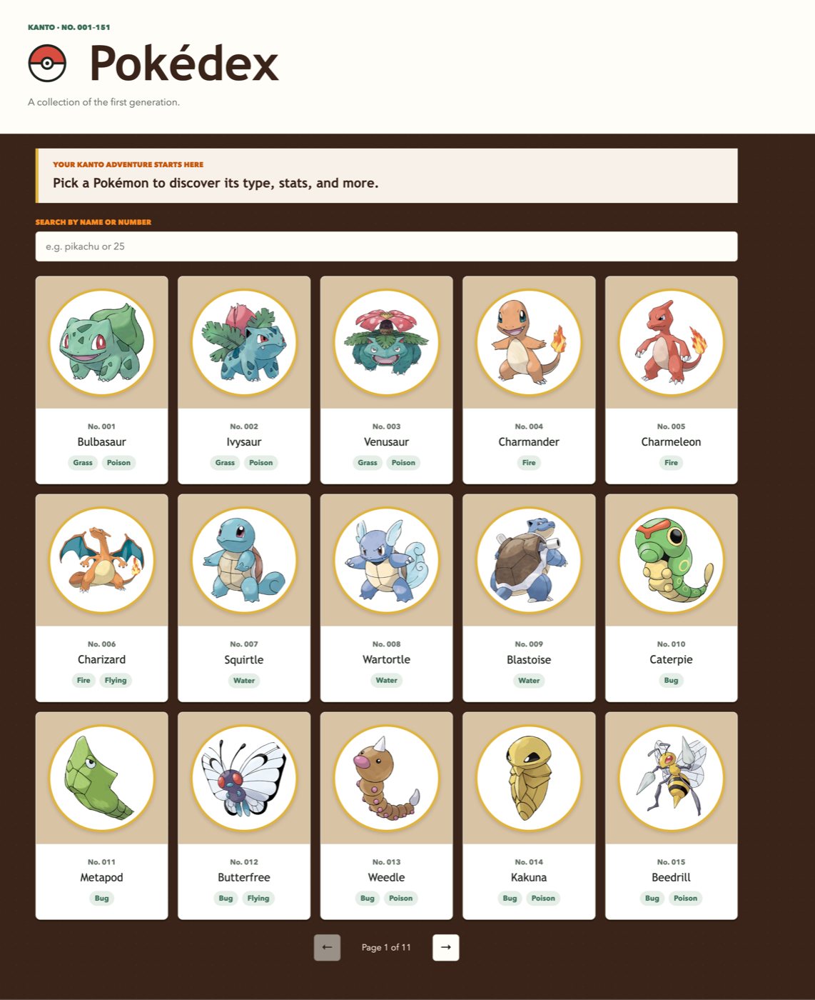

# Pokédex

A responsive Pokédex of the first generation (Kanto, No. 001–151), built with vanilla JavaScript and data from the [PokéAPI](https://pokeapi.co/).



## Features

- Browse all 151 first-generation Pokémon in a paginated grid
- Search by name or number
- Open a detail view with official artwork, types, base stats, height and weight
- Accessible by design: semantic HTML, native `<dialog>`, keyboard support and ARIA live regions
- Graceful error handling when the API is unavailable

## Built with

- HTML5 and CSS3 (BEM-style naming)
- JavaScript (ES modules, `async/await`, `fetch`)
- [PokéAPI](https://pokeapi.co/)

## Run it locally

No build step or dependencies are needed. ES modules require a local server, so open the project with one, for example:

```bash
npx serve .
```

or use the Live Server extension in VS Code.

## What I practiced

- Fetching and combining data from multiple API requests
- Building DOM elements safely, without `innerHTML`
- Event delegation and pagination logic
- Writing accessible, responsive interfaces
